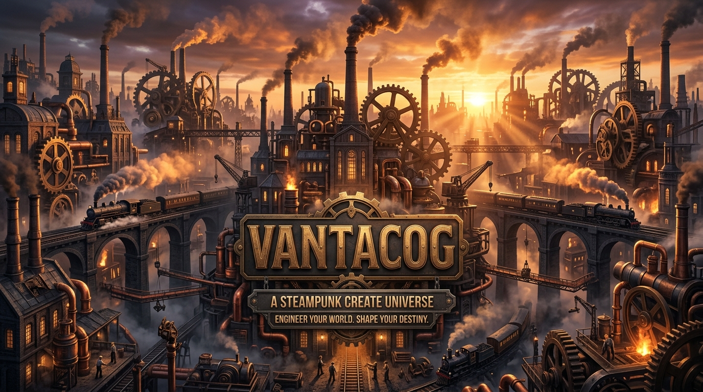

# ⚙️ VANTACOG — A Steampunk Create Universe

<p align="center">
  
</p>

<p align="center">
  <strong>ENGINEER YOUR WORLD. SHAPE YOUR DESTINY.</strong><br>
  <em>Buhar makineleri, demiryolları, fabrikalar ve mekanik medeniyetin fantastik keşifle buluştuğu modlu Minecraft evreni.</em>
</p>

<p align="center">
  
  
  
  
  
</p>

---

## 🧭 1. VANTACOG Nedir?

**VANTACOG**, *Create* teknolojisi, steampunk mühendisliği, demiryolu ağları ve alternatif sanayi devrimi atmosferini bir araya getiren kapsamlı bir Minecraft 1.21.1 NeoForge modpack ve sunucu projesidir.

Oyuncular kendi buhar makinelerini inşa eder, fabrikalarını otomatikleştirir, devasa demiryolu ağlarıyla kıtaları birbirine bağlar ve mekanik medeniyetin bir parçası olurlar.

### 🌟 Öne Çıkan Özellikler:
- 🚂 **Buhar & Mekanik Otomasyon:** *Create* ve zengin eklenti ekosistemi (Big Cannons, TFMG, Metallurgy, Steam & Rails, Diesel Generators).
- 🪐 **Teknolojik Keşif:** *Ad Astra* ile uzay ve gezegen keşfi, *Applied Energistics 2* ile dijital depolama ve lojistik.
- ⚡ **Optimize Edilmiş Performans:** *Sodium*, *Iris Shaders*, *FerriteCore*, *ModernFix*, *BadOptimizations* ile yüksek FPS ve kararlılık.
- 🎙️ **Gerçekçi İletişim:** *Simple Voice Chat*, *Simple Radio Station* ve *Walkie-Talkie Plus* ile dinamik telsiz ve mesafe bazlı sesli sohbet.
- 🔄 **Sıfır Bakım (Packwiz):** Oyuncuların her güncellemede dosya indirmesine gerek kalmaz; oyun açılırken yeni/değişen modlar otomatik indirilir.

---

## 📌 2. Sunucu Bağlantı Bilgileri

Sunucumuz yüksek performanslı dedicated altyapı üzerinde 7/24 aktiftir:

- **Sunucu Adresi (IP):** `domination-turtles.tun.ply.gg:60822`
- **Sürüm:** Minecraft Java `1.21.1` (NeoForge `21.1.265`)
- **Discord Topluluğu:** [https://discord.gg/pPZUpZY2AW](https://discord.gg/pPZUpZY2AW)

*(Modpack'i kurduğunuzda sunucu adresi Multiplayer listenize otomatik olarak eklenmiş gelir).*

---

## 🚀 3. Hızlı Kurulum (Prism Launcher)

### Gereksinimler:
1. **[Prism Launcher](https://prismlauncher.org/download/):** İndirin ve kurun.
2. **Java 21:** Bilgisayarınızda Java 21 kurulu olmalıdır ([Adoptium Temurin 21](https://adoptium.net/temurin/releases/?version=21)).
3. **Bellek (RAM):** En az **6 GB**, önerilen **8 GB** RAM.

### Adım Adım Kurulum:
1. Bu deponun [Releases](../../releases) kısmından en güncel **`VANTACOG-Prism-Distribution.zip`** dosyasını indirin (ZIP dosyasını açmayın).
2. Prism Launcher'ı açın ve sol üstteki **Add Instance (Yeni Örnek Ekle)** butonuna tıklayın.
3. Sol menüden **Import (İçe Aktar)** seçeneğini seçin ve indirdiğiniz `VANTACOG-Prism-Distribution.zip` dosyasını gösterip **Tamam** deyin.
4. Oluşan `VANTACOG` profiline sağ tıklayıp **Edit (Düzenle) -> Settings -> Java** sekmesinden maksimum RAM miktarını **6144 MB** veya **8192 MB** yapın.
5. `VANTACOG` profilini başlatın! İlk açılışta Packwiz tüm modları resmi kaynaklardan (~1-2 dakika içinde) otomatik indirecektir.

---

## 📦 4. Dağıtım Paketleri & Güvenlik Doğrulaması

Tüm mod dosyaları doğrudan resmi **Modrinth CDN** ve **CurseForge API** altyapısından SHA-512 / SHA-1 sağlama toplamlarıyla çekilir. Dağıtım ZIP'i içinde All Rights Reserved lisanslı ham mod ikilileri barındırılmaz; yalnızca resmi açık kaynaklı Packwiz bootstrap yükleyicisi ve yapılandırma şablonları bulunur.

| Dosya | Boyut | Açıklama | SHA-256 Sağlama Toplamı |
|---|---|---|---|
| **`VANTACOG-Prism-Distribution.zip`** | `436.7 KB` | Prism Launcher temiz kurulum paketi (v1.0.1) | `8c074dc2e7285337687d378a645455bba56625f7adcebae7f7f5fc9a3014db63` |
| **`packwiz-installer-bootstrap.jar`** | `98 KB` | Resmi Packwiz otomatik yükleyicisi (comp500 / MIT) | `a8fbb24dc604278e97f4688e82d3d91a318b98efc08d5dbfcbcbcab6443d116c` |

🔍 **VirusTotal Doğrulama Bağlantısı:**  
[VirusTotal SHA-256 Analiz Sayfası](https://www.virustotal.com/gui/file/8c074dc2e7285337687d378a645455bba56625f7adcebae7f7f5fc9a3014db63)

---

## 🔧 5. Modpack Yöneticileri İçin (Packwiz Mimarisi)

Bu depo aynı zamanda modpack'in Packwiz merkezi metadata kaynağıdır:

- `pack.toml`: Ana paket tanımı ve index referansı.
- `index.toml`: 218 mod metadata dosyasının bütünlük listesi.
- `mods/`: Her modun Modrinth/CurseForge indirme yönergelerini içeren `.pw.toml` dosyaları.

Packwiz doğrudan raw bağlantısı:
```text
https://raw.githubusercontent.com/JustCyrr/VANTACOG/main/pack.toml
```

---

## 🎖️ 6. Teşekkürler ve Eser Sahipleri (Credits)

VANTACOG projesi, Minecraft modlama topluluğunun eşsiz yaratıcılığı ve açık kaynak katkıları sayesinde hayata geçmiştir. Tüm mod geliştiricilerine, topluluk katkıcılarına ve sanatçılara içtenlikle teşekkür ederiz.

- Ayrıntılı geliştirici ve ekip listesi için: [CREDITS.md](CREDITS.md)
- Başlıca içerik yaratıcıları:
  - **The Create Team (simibubi ve katkıcılar):** Mekanik Create motoru ve otomasyon ekosistemi.
  - **Embeddedt:** ModernFix optimizasyon altyapısı.
  - **CaffeineMC / JellySquid / IMS:** Sodium ve Iris grafik teknolojisi.
  - **Technici4n & shartte:** Applied Energistics 2 dijital lojistik motoru.
  - **Henkelmax:** Simple Voice Chat ve Corpse çok oyunculu entegrasyonları.

---

## 📜 7. Üçüncü Taraf Lisansları & Dağıtım Şartları

Bu pakette yer alan 218 modun her biri kendi bağımsız lisans şartlarına tabidir:
- **Telif Haklarına Saygı:** Depomuzda All Rights Reserved veya kısıtlayıcı lisanslara sahip hiçbir üçüncü taraf ikili `.jar` dosyası barındırılmamaktadır. Modlar Packwiz aracılığıyla istemci tarafından resmi Modrinth/CurseForge CDN sunucularından indirilir.
- **218 Modun Tam Lisans Envanteri:** Her bir modun geliştiricisi, lisans türü, platform bağlantısı ve kaynak kodu için [THIRD_PARTY_LICENSES.md](THIRD_PARTY_LICENSES.md) belgesini inceleyiniz.

---

## ⚖️ 8. Marka ve Telif Hakkı Feragatnamesi (Legal Disclaimer)

- **NOT AN OFFICIAL MINECRAFT PRODUCT. NOT APPROVED BY OR ASSOCIATED WITH MOJANG OR MICROSOFT.**
- Minecraft, Mojang Synergies AB / Microsoft şirketinin ticari markasıdır.
- NeoForge, NeoForged projesinin markasıdır.
- CurseForge, Overwolf şirketinin markasıdır.
- Modrinth, Rinth, Inc. şirketinin markasıdır.
- Prism Launcher, Prism Launcher Contributors topluluğunun markası/projesidir.
- Bu projede bahsi geçen tüm ticari markalar ve fikri mülkiyet hakları ilgili eser ve hak sahiplerine aittir. VANTACOG projesi bu kurum veya kuruluşlarla doğrudan bir ortaklığa veya onaya sahip değildir.

---

## 📬 9. İletişim ve Telif Bildirimi (Takedown & Support)

Eğer bu modpack içerisinde yer alan herhangi bir modun telif hakkı sahibiyseniz ve modunuzun Packwiz metadata listesinde yer almasını istemiyorsanız, lütfen Discord üzerinden veya GitHub Issues açarak bizimle iletişime geçiniz. Talebiniz doğrultusunda mod derhal metadata fihristinden kaldırılacaktır.

- **Discord Topluluğu:** [https://discord.gg/pPZUpZY2AW](https://discord.gg/pPZUpZY2AW)
- **GitHub Issues:** [https://github.com/JustCyrr/VANTACOG/issues](https://github.com/JustCyrr/VANTACOG/issues)

---

<p align="center">
  <em>VANTACOG Universe © 2026. All rights reserved by respective mod authors.</em>
</p>
